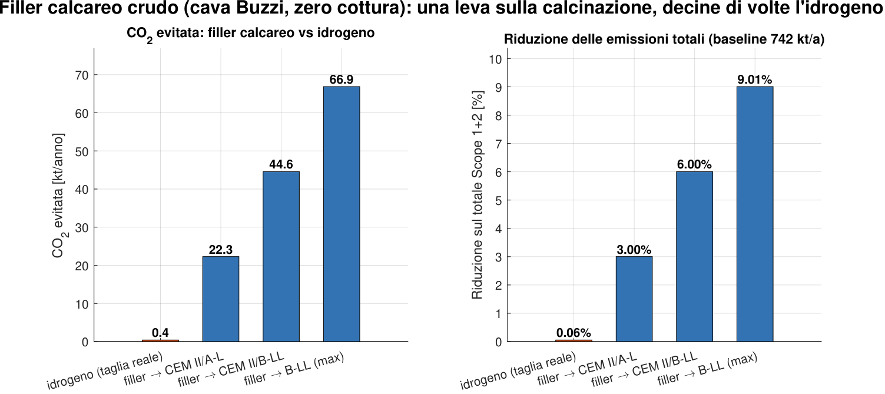
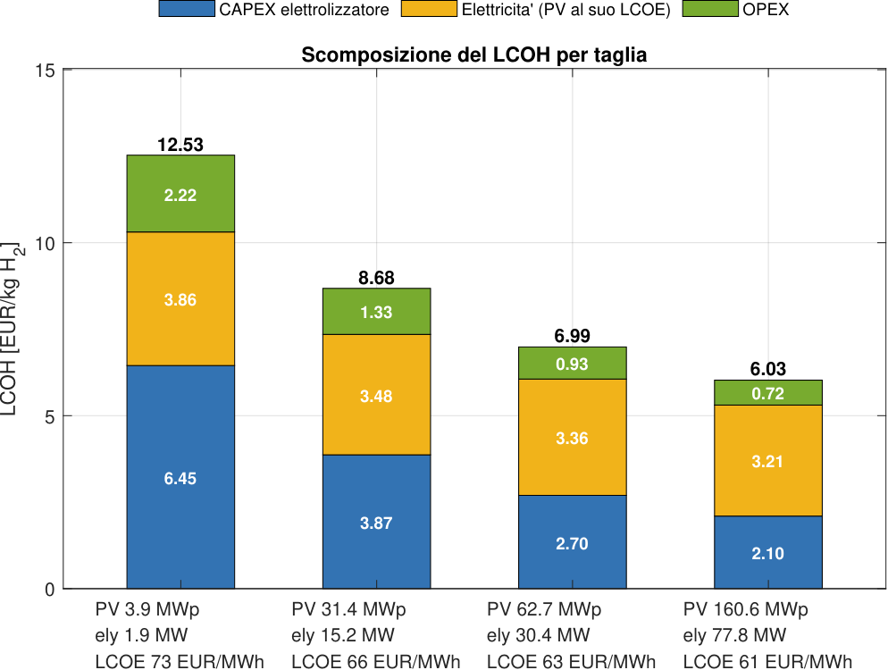

# Decarbonising a cement plant: green hydrogen or less clinker?

Case study on the Buzzi cement plant in Barletta (Italy), 742 kt CO2 per year, built on public data.

## Question

Can on-site solar power and green hydrogen cut the plant's CO2 at a sensible cost, or is there a better lever?

## Answer

**Hydrogen does not pay.** At the size the site can host (3.95 MWp of PV, a 1.9 MW electrolyser) green H2 replaces 0.13% of the kiln's fuel,
<!-- src: model/risultati_KPI.csv l.41, l.43, l.47 -->
costs 12.5 €/kg and loses 3.3 M€ over 20 years: about 2,500 € per tonne of CO2 avoided, 31 times the EU ETS price.
<!-- src: report/slides.pdf p.27 (LCOH, NPV), p.32 (abatement cost, 31x ETS) -->

**Recommended instead, with what the site already has:**
- Rooftop PV for self-consumption: NPV +5.9 M€, 4-year payback, about 873 t CO2 per year.
  <!-- src: report/slides.pdf p.33 (NPV, payback), p.34 (873 t) -->
- Raw limestone filler in place of clinker, up to the EN 197-1 limit (CEM II/B-LL): about 67 kt CO2 per year, 9% of the plant's emissions, at about 59 €/t, below the ETS price.
  <!-- src: report/slides.pdf p.32 (59 EUR/t), p.35 (66.9 kt, 9.01%) -->

About 369 kt CO2 per year of process emissions from calcination remain, which only carbon capture can address.
<!-- src: report/slides.pdf p.35 -->

## Method

- **Baseline:** energy and CO2 balance of the plant from its sustainability report, environmental permit (AIA) and emissions monitoring: 59% of the CO2 comes from calcination, 36% from fuel, 5% from electricity.
- **Hourly simulation over two years:** the kiln runs in campaigns (43% of the hours), PV output from the real PVGIS-SARAH3 profile of the site.
- **Sizing:** PV, inverter, electrolyser and hydrogen co-firing at the size the site can host, a size study from 1% to 5% fuel substitution, and battery and hydrogen storage cases.
- **Economics:** CAPEX with economies of scale, levelised cost of hydrogen (European Hydrogen Observatory method), NPV over 20 years at 6%, abatement cost against the EU ETS price (80 €/t).

*CO2 avoided per year and cut in total emissions: hydrogen at the installable size against three levels of clinker substitution (labels in Italian).*

*Cost of hydrogen by plant size, split into electrolyser CAPEX, electricity and OPEX: even at 40 times the site's area it stays above 6 €/kg.*

## Files

- [Slides](report/slides.pdf): the full study, 37 slides (Italian).
- [Data sources](report/data-sources.pdf): every input, with its source and how it is used (Italian).
- [MATLAB model](model/progetto_cementificio.m): run it from `model/`; it writes `risultati_KPI.csv` and the figures.
- Inputs in `model/`:
  - `pvgis_barletta_2013_sarah3.csv`: real hourly PV profile, converted by `converti_pvgis.py` from the PVGIS download `pvgis_raw_2013.json`.
  - `emissioni_barletta_2024_2025.csv`: **synthetic** daily kiln operation, calibrated on the plant's declared annual values (`ricostruisci_dati.py`).

**Limits.** The cost of clinker substitution is a literature value, not modelled in detail. The kiln's daily operation is synthetic. The burner retrofit cost (3 M€) is an estimate.

## Context

Individual project, *Progettazione di impianti a energia rinnovabile* (Design of renewable energy plants), University of Pisa, June 2026.
Sources: Buzzi Sustainability Report 2023, AIA permit (Regione Puglia n. 40/2012), PVGIS-SARAH3 (JRC), GCCA Roadmap 2022, EU Cement BREF, European Hydrogen Observatory 2025, EN 197-1.
